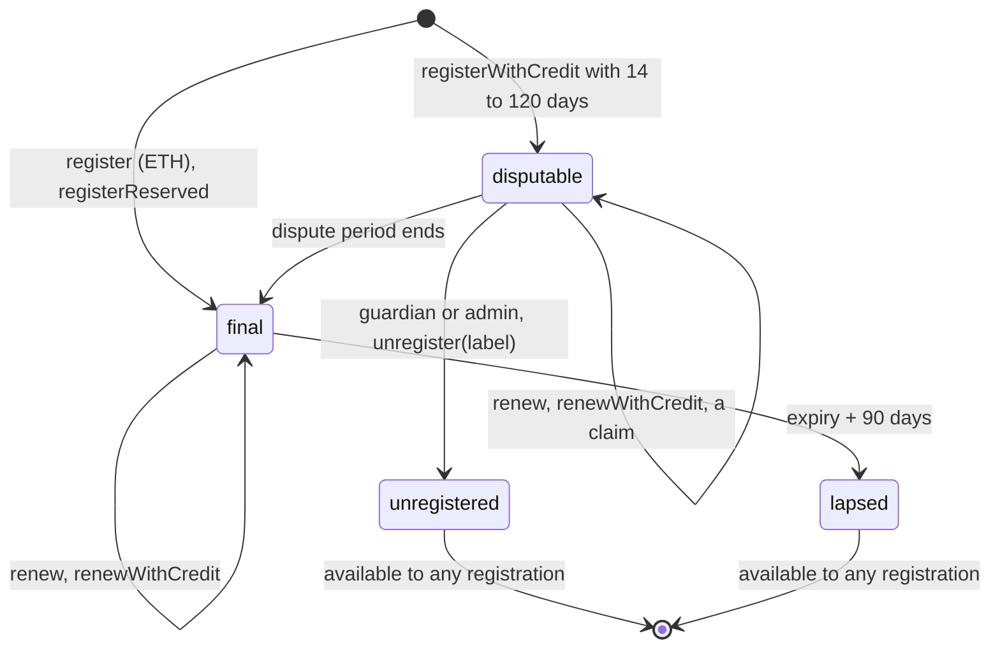
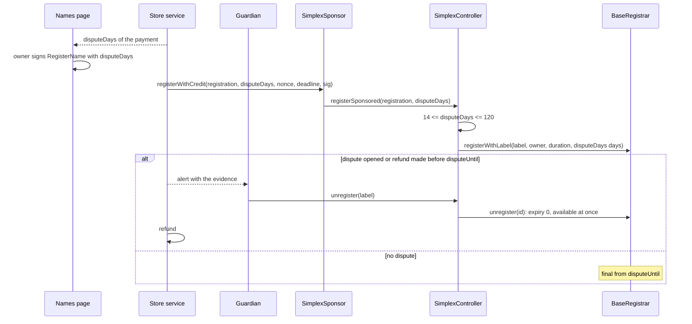
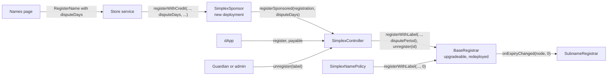

# Dispute period — contract work plan

Built on `simplex-namespace-contract` @ `c1cca32` and `ens-contracts` @ `1a11cda` (tag `simplex-mainnet-v1`, deployed), stacked on [ens-contracts #49](https://github.com/simplex-network/ens-contracts/pull/49) (`7ff8c37`). Replaces the reversible-payments plan, `docs/plans/payment-reversal.md` on the branch `ab/payment-reversal`, which is kept aside. `BaseRegistrarImplementation` is redeployed as an upgradeable contract by a separate change, the branch `ab/upgradeable-stack`, which comes before #49; this plan adds the dispute period to it.

## 1. Problem

A card payment can be disputed or refunded for about 120 days after it settles, and the money is withdrawn from the store; the buyer keeps the name for its whole paid term ([Stripe](https://docs.stripe.com/disputes/how-disputes-work)). A registration made with a compromised store key is final at once.

## 2. Decisions

| # | Decision | Applied | Status |
|---|---|---|---|
| D1 | Term | the whole paid term at registration | the owner, 19 Nov |
| D2 | Dispute period | defined by each sponsored registration; before its end the guardian or the admin unregisters the name | the owner, 19 Nov |
| D3 | Days | card 120; BTC and XMR 14; ETH in the dApp 0 | the owner, 19 Nov |
| D4 | Bounds on the sponsored path | at least 14 days, at most 120, on chain | the owner, 19 Nov (minimum) |
| D5 | An unregistered name | available to anyone at once; the store refunds the payment; no reinstatement | the owner, 19 Nov |
| D6 | Renewals | final; after a disputed renewal the guardian reserves the name, so its next renewal is refused | the owner, 19 Nov |
| D7 | Registrar upgrades | the admin, through the registrar's own ProxyAdmin, until that ProxyAdmin's ownership is renounced, independently of `controller.freeze()` | the owner, 19 Nov |
| D8 | Transfers during the dispute period | allowed; clients show the dispute end and ask the recipient's acknowledgement | the owner, 18 Nov |
| D9 | What is public | each name's `disputeUntil` | the owner, 18 Nov |
| D10 | Who unregisters | the guardian or the admin | decided |
| D11 | Placement | the registrar stores `disputeUntil`, written only at registration, and unregisters only before it; the controller's `unregister(label)` for the guardian and the admin | decided |
| D12 | Unregistration | the expiry set to 0 and the registry node's owner to 0; the default resolver's records cleared; the next registration burns the token and invalidates the subnames, as for a lapsed name | decided |
| D13 | In-app payments and codes | in-app 120 days; a code takes the days of the payment that bought it, at least 14 | decided |

## 3. States



| State | `unregister` | claim | renewal | `available` |
|---|---|---|---|---|
| disputable, before `disputeUntil` | guardian or admin | allowed; clients ask for an acknowledgement | allowed | false |
| final | `DisputePeriodOver` | as #49 | as #49 | false |
| unregistered | `DisputePeriodOver` | refused by `ownerOf` | refused by the registrar's `renew` | true |

```
BaseRegistrarImplementation
  disputeUntil      mapping(uint256 => uint256)   public, written only at registration

  registerWithLabel(label, owner, duration, disputePeriod)              controller only
    ... as #49
    disputeUntil[id] = block.timestamp + disputePeriod

  unregister(id)                                                         controller only, live
    block.timestamp < disputeUntil[id]                                   else DisputePeriodOver(id)
    delete disputeUntil[id]
    expiries[id] = 0
    ens.setSubnodeOwner(baseNode, id, 0)
    subnameHook.onExpiryChanged(node, 0)
    emit NameUnregistered(id)

SimplexController
  register(registration)                                                 payable
    ... as #49, disputePeriod 0
  registerSponsored(registration, disputeDays)                           sponsor only
    MIN_DISPUTE_DAYS <= disputeDays <= MAX_DISPUTE_DAYS                  else DisputeDaysOutOfRange(disputeDays)
    ... as #49, disputePeriod = disputeDays days
  unregister(label)                                                      owner or beneficiary
    base.unregister(uint256(keccak256(label)))
    _retireStaleRecords(namehash)

SimplexNamePolicy.registerReserved(label, owner, duration)
  ... as #49, disputePeriod 0

SimplexSponsor.registerWithCredit(registration, disputeDays, nonce, deadline, sig)
  RegisterName(string label,address owner,uint256 duration,address resolver,bytes[] data,uint256 disputeDays,uint256 nonce,uint256 deadline)
  ... as #49
  controller.registerSponsored(registration, disputeDays)
```

Example: a two-year card registration on day 0 with 120 days expires on day 730. Disputed on day 30, it is unregistered by the guardian on day 31, available to anyone at once, and the store refunds the payment. Undisputed, it is final from day 120.



## 4. Threat model

| Who or what | Power after the change | Bound |
|---|---|---|
| a buyer who disputes a registration | gets the money back | the name is unregistered and available at once |
| a holder who disputes a renewal | keeps the renewed term | the guardian reserves the name, so it is not renewed again (D6) |
| a compromised store key | registers names to its own address, or with owners' signatures | each is unregistered by the guardian for at least 14 days (D4) |
| the guardian | unregisters any name in its dispute period, up to 120 days after its registration | one key until GOV8; a dispute period ends on its own; ETH registrations and `registerReserved` take none |
| a recipient of a claim during the dispute period | loses the name on an unregistration | clients show the dispute end and ask for an acknowledgement (D8) |
| a registrar controller added by the admin | unregisters a name in its dispute period | as every controller power, behind the timelock from GOV8; a final name stays final |
| an observer of the chain | learns each name's dispute end, so 0, 14 or 120 days | public by D9 |

## 5. Contract changes



`BaseRegistrarImplementation`:

- `disputeUntil`, public;
- `registerWithLabel` takes `disputePeriod`;
- `unregister(uint256)`, controller only;
- event `NameUnregistered(uint256 indexed id)`;
- error `DisputePeriodOver(uint256 id)`.

`SimplexController`:

- `MIN_DISPUTE_DAYS = 14`, `MAX_DISPUTE_DAYS = 120`;
- `registerSponsored(registration, disputeDays)`;
- `_registerCore` takes the dispute period, which `register` passes as 0;
- `unregister(string label)`, owner or beneficiary;
- error `DisputeDaysOutOfRange(uint256)`.

`SimplexNamePolicy`: `registerReserved` registers with 0.

`SimplexSponsor`, a new deployment: `registerWithCredit(registration, disputeDays, nonce, deadline, sig)` and `RegisterName` with `uint256 disputeDays`; `renewWithCredit` as #49.

## 6. Effects outside this repository

- simplex-chat, store service: `disputeDays` per payment by D3 and D13, in the `RegisterName` digest and calldata, with a reveal refused when signed over another value; on `charge.dispute.created` or `charge.refunded` before `disputeUntil`, the guardian's `unregister(label)` and the refund; after a disputed renewal, the guardian's `addReservedNames`.
- simplex.domains: `RegisterName` with `disputeDays`; the dispute end on the order page.
- The app's claim flow and the dApp's claim review: the dispute end before a claim, with the recipient's acknowledgement (D8).
- The names resolver: a name with expiry 0 answers as unregistered.
- This repository: the deployment scripts and the documents for the redeployed registrar, with the registrar's upgradability change.

## 7. Tests

`ens-contracts/test/simplex/TestDisputePeriod.test.ts`:

- a sponsored registration stores `disputeUntil` as its time plus the days; 14 and 120 days register, 13 and 121 revert `DisputeDaysOutOfRange`;
- the payable `register` and `registerReserved` store a dispute end of their own block, so `unregister` reverts `DisputePeriodOver` at once;
- `RegisterName` with other `disputeDays` reverts `InvalidSignature`; the type hash is pinned;
- `unregister` by the guardian and the admin before `disputeUntil`; by the registrar key, the holder and anyone else it reverts; at `disputeUntil` it reverts `DisputePeriodOver`;
- after `unregister`: `nameExpires` 0, `available` true, `ownerOf` reverts, the registry node's owner 0, the default resolver's records empty, the subnames without owner, a claim, a renewal and a record write by the old holder revert, and a second `unregister` reverts;
- a registration after `unregister`, by anyone: the old token burned, the subnames of the old holder without owner, the records cleared;
- a claim during the dispute period moves the name, and an `unregister` then takes it from the recipient;
- a renewal during the dispute period, then `unregister`: the expiry is 0;
- a re-registration writes a new dispute end;
- the registrar's `unregister` reverts for every caller but a controller;
- each new guard, removed, fails at least one test.
